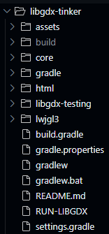

# Entry 1
##### 11/13/2026

### Context

On my APCSA Freedom project, I have decided on using Libgdx as my tool. This is because Libgdx is a java tool that is used to make 2d/3d games and my game idea is a infinite runner game where the player will try keep a character running as long as it can without dying. I tried to tinker with Libgdx but it took a lot of setup to use in my codespace. When I went to the Libgdx website to download the starting code, I had to download a large group of files. This is what it looks like:



Before I could start coding, I had to find a way to run the files because using `http-server` didn't work for libgdx. I tried searching for an answer using google and youtube but I couldn't find anything so I decided to use ChatGpt to search for a way to open it in my codespace. Then I used the tutorial it gave me to figure out how it worked. First I had to run `python3 -m http.server 8080 --bind 0.0.0.0 --directory html/build/dist` in the terminal to open a port in the ports section. Then, if I typed any new code, I had to run `./gradlew html:dist` to update the edits to the port. After that, I could finally start tinkering. In the `LibgdxTest.java` file, there was starting code that was ready for me to use. This is what it looked like:

```java
package com.libgdxtext;

import com.badlogic.gdx.ApplicationAdapter;
import com.badlogic.gdx.graphics.Texture;
import com.badlogic.gdx.graphics.g2d.SpriteBatch;
import com.badlogic.gdx.utils.ScreenUtils;

/** {@link com.badlogic.gdx.ApplicationListener} implementation shared by all platforms. */
public class LibgdxTest extends ApplicationAdapter {
    private SpriteBatch batch;
    private Texture image;

    @Override
    public void create() {
        batch = new SpriteBatch();
        image = new Texture("libgdx.png");
    }

    @Override
    public void render() {
        ScreenUtils.clear(0.15f, 0.15f, 0.2f, 1f);
        batch.begin();
        batch.draw(image, 240, 110);
        batch.end();
    }

    @Override
    public void dispose() {
        batch.dispose();
        image.dispose();
    }
}

```

This code created an image of the Libgdx logo on the screen. I tinkered with this by moving it around by changing the x and y values of the image. Then, I started to create multiple logos in different places. After that, I added my own picture of a cat to the assets file and added it to my code and created an image of a cat on the screen. I am planning on creating a sprite for my next learning log by using this [example](https://libgdx.com/wiki/start/a-simple-game) from the Libgdx wiki. I also looked at the [Libgdx wiki](https://libgdx.com/wiki/) to search for how to make sprites.

### EDP (Engineering Design Process)

I am on the second step of the engineering design process, which is researching the problem. First, I have to learn how to make sprites and animation for my game by watching videos and looking at Libgdx tutorials and the wiki. I am going to be on this step for a while because I have just begun learning Libgdx and I am going to have to learn about it for a few months before coding my game.

### Skills

#### How to learn

I have improved in the skill of how to learn by looking up tutorials and using ChatGpt to learn how to add Libgdx. I have also improved in this skill by creating my own examples of tutorials and code snippets to help me understand how each part of the code works.

#### Time management

I have also improved in time management by balancing APCSA with my other ap classes, college aplications, and volleyball. I have gotten better at prioritizing more important task over others like completing my college aplications and my homework over going to volleyball practice.

[Next](entry02.md)

[Home](../README.md)